# Dairy Campus Research Data Platform: Metadata & Calculation Models

[](https://creativecommons.org/licenses/by/4.0/)
[](https://opensource.org/licenses/MIT)
[](https://zenodo.org/)
[](https://www.go-fair.org/fair-principles/)

This repository provides the complete, standardized **FAIR Metadata Specifications**, **Variable Dictionaries**, **Trial Extraction Queries**, and **Data Processing Calculation Models** for the [Dairy Campus](https://www.dairycampus.nl/) research facility (Wageningen University & Research, Leeuwarden, the Netherlands). 

It is designed as the direct foundation for deposition and long-term scientific archiving on **[Zenodo](https://zenodo.org/)**.

---

## 1. About Dairy Campus

**Dairy Campus** is the leading national and international research and innovation center for dairy farming in the Netherlands, operated by **Wageningen University & Research (WUR)**. Dairy Campus houses over 500 dairy cows equipped with state-of-the-art Precision Livestock Farming (PLF) sensors, automated feeding robots, electronic feeders, automated milking systems, emission measurement chambers, and real-time behavioral tracking systems.

Scientific experiments conducted at Dairy Campus investigate:
- Cattle nutrition, feed efficiency, and enteric greenhouse gas emissions ($\text{CH}_4$ and $\text{CO}_2$).
- Precision cow health, welfare, longevity, and behavioral time-budgets.
- Sustainable barn climate, nitrogen and carbon cycles, and circular dairy production.

---

## 2. Repository Structure

```
.
├── README.md                      # Primary project overview and Zenodo guide (this document)
├── LICENSE                        # Dual licensing: CC-BY-4.0 (Metadata) & MIT (Software)
├── CITATION.cff                   # Citation File Format for GitHub and Zenodo citation indexing
├── .zenodo.json                   # Machine-readable deposit metadata descriptor for Zenodo
├── Metadata-2.xlsx                # Source Excel data catalog
│
├── data_dictionary/               # Standardized FAIR data dictionaries (in English)
│   ├── README.md                  # Detailed overview of datasets and domain schemas
│   ├── datapackage.json           # Frictionless Data Package schema specification
│   ├── tables/                    # Comprehensive Markdown documentation per dataset (19 files)
│   │   ├── TVL_total.md           # Master daily integrated cow summary (97 variables)
│   │   ├── Hokofarm_RIC.md        # Individual roughage trough visit transactions
│   │   ├── Hokofarm_SAC_concentrates.md # Individual concentrate feeding transactions
│   │   ├── TVL_RIC_intake_dm.md   # Daily roughage and dry matter intake
│   │   ├── Triomatic_RIC_load.md  # Feeding robot mixer loading batches
│   │   ├── Triomatic_RIC_drop.md  # Feeding robot trough deliveries
│   │   ├── GEA_milkings.md        # Milking sessions, conductivity, and yields
│   │   ├── GEA_gates.md           # Automated selection gate passages
│   │   ├── TMR_Trioliet_cowconnect_mix.md  # Mixer wagon TMR batches
│   │   ├── TMR_Trioliet_cowconnect_drop.md # TMR feed fence distribution
│   │   ├── Velos_behaviour.md     # Nedap Smarttag behavior intervals
│   │   ├── Velos_behaviour_day.md # Nedap Velos daily behavior time-budgets
│   │   ├── DC_DM_content.md       # Laboratory oven dry matter determinations
│   │   ├── Greenfeed_summarized_data.md    # C-Lock GreenFeed enteric emissions
│   │   ├── Greenfeed_feed_aggregrated.md   # GreenFeed bait feed drops
│   │   ├── Weatherstation.md      # On-site meteorological observations
│   │   ├── Missing_data.md        # Automated data quality & completeness flags
│   │   ├── Environment_barn_Animal_day.md  # Barn location & daily animal profile
│   │   └── Environment_barn_Animal_experim.md # Experimental cohort daily tracking
│   └── csv/                       # Machine-readable CSV dictionaries (19 tables + master)
│       ├── TVL_total.csv
│       ├── ...
│       └── all_metadata_dictionary.csv # Master dictionary with all 507 variables
│
├── reports/                       # SQL data extraction queries from Apache Airflow
│   ├── README.md                  # Documentation of extraction queries and [prfcod] usage
│   ├── TVL_Total.sql              # Master daily record export per experiment
│   ├── TVL_RIC_intake_dm.sql      # Trial roughage intake and dry matter export
│   ├── Velos_behaviour_day.sql    # Trial daily behavior budgets export
│   ├── Greenfeed_summarized_data.sql # Trial enteric emissions export
│   └── ... (30 SQL queries)
│
├── calculations/                  # Calculation logic and SQL models from database
│   ├── README.md                  # Comprehensive explanation of formulas and workflows
│   ├── procedures/                # Stored procedures (ETL, materialization, daily builds)
│   ├── views/                     # Calculation views (water subtraction, joins, DM conversion)
│   ├── functions/                 # Deterministic scalar and table-valued functions
│   └── reports/                   # Core aggregation reports (e.g. DCTotaal.sql)
│
└── scripts/                       # Maintenance and documentation generation utilities
    └── generate_documentation.py  # Python script to regenerate dictionaries from source
```

---

## 3. Data Flow & Provenance Architecture

```mermaid
flowchart LR
    subgraph Sensors["1. High-Frequency PLF Sensors"]
        direction TB
        S1["Hokofarm RIC<br/>(Roughage intake)"]
        S2["SAC / Hokofarm<br/>(Concentrate stations)"]
        S3["Trioliet Triomatic<br/>(Feeding robot)"]
        S4["GEA Milking Robot<br/>(Yield, conductivity)"]
        S5["Nedap Velos<br/>(Activity, rumination)"]
        S6["C-Lock GreenFeed<br/>(CH4, CO2 flux)"]
        S7["Weatherstation<br/>(Temperature, rain)"]
        S8["Lab Dry Oven<br/>(DM% testing)"]
    end

    subgraph Calculations["2. Calculations & Views (calculations/)"]
        direction TB
        C1["Water Exclusion:<br/>(TotalLoad - Water) / TotalLoad"]
        C2["Dry Matter Intake:<br/>Intake * (DM% / 100)"]
        C3["Concentrate Intake:<br/>Programmed - Residual"]
        C4["Milk Components:<br/>Fat%, Protein%, Lactose%, SCC"]
        C5["Behavior Budgets:<br/>Daily Eating, Ruminating, Lying"]
        C6["Data Quality Matrix:<br/>Missing observation flags"]
    end

    subgraph Pipeline["3. Airflow Pipeline (reports/)"]
        direction TB
        A1["Extract trial data<br/>WHERE prfcod = '[prfcod]'"]
        A2["Generate SQLite / CSV / XLSX<br/>research deliverables"]
    end

    subgraph Zenodo["4. Scientific Archiving"]
        direction TB
        Z1["Zenodo DOI Repository"]
        Z2["FAIR Research Data"]
    end

    Sensors --> Calculations
    Calculations --> Pipeline
    Pipeline --> Zenodo
```



---

## 4. Key Calculation Models

All calculations are fully documented in [`calculations/README.md`](calculations/README.md) and include:

1. **Roughage Intake & Dry Matter Correction**:
   - Individual visit weights from Hokofarm RIC load cells.
   - Water exclusion subtraction based on Trioliet Triomatic mixer wagon loading logs:
     $$\text{Intake}_{\text{excl\_water}} = \text{Intake}_{\text{fresh}} \times \frac{\sum \text{TotalLoaded} - \sum \text{AddedWaterKg}}{\sum \text{TotalLoaded}}$$
   - Total daily dry matter intake:
     $$\text{DMI} = \sum_{i=1}^{4} \left( \text{Intake}_{\text{excl\_water}, i} \times \frac{\text{DM}_{\%, i}}{100} \right)$$
2. **Concentrate Allowance & Consumption**:
   - Dispensed across SAC stations and GEA in-parlor feeders.
   - Calculation: $\text{Intake} = \text{QuantityProgrammed} - \text{QuantityRemaining}$.
3. **Milk Yield & Quality Testing**:
   - Morning, evening, and daily totals ($\text{KgMlkEtm} = \text{KgMlkO} + \text{KgMlkA}$).
   - Routine 4-weekly laboratory testing (MPR): Fat %, Protein %, Lactose %, Urea, Somatic Cell Count (`CelStd`), and diagnostic ketosis code (`KetStd`).
4. **Behavioral Budgets (Nedap Velos Smarttags)**:
   - High-resolution intervals aggregated into 24-hour budgets for eating, ruminating, inactivity (lying), and active locomotion.
5. **Enteric GHG Emissions (C-Lock GreenFeed)**:
   - Automated head-proximity detection, airflow corrections (`AirflowCf`), bait feeding rewards, and gas differential integration yielding mass flux estimates (g $\text{CH}_4$/day and g $\text{CO}_2$/day).
6. **Automated Data Quality & Completeness Validation**:
   - Implementation in [`TVL_Totaal_missende_data_proef.sql`](calculations/views/TVL_Totaal_missende_data_proef.sql) identifying days with sensor dropouts, missing weights, incomplete milking, or transponder detachment ($< 50,000$ seconds recorded).

---

## 5. Zenodo Deposition Guide

This repository is pre-configured to be deposited directly to **Zenodo** via the official GitHub-Zenodo integration or manual deposit:

1. **Metadata Specification**:
   - [`.zenodo.json`](.zenodo.json) automatically populates the title, authors, affiliations, description, keywords, license, and open-access status on Zenodo.
2. **Citation Support**:
   - [`CITATION.cff`](CITATION.cff) allows GitHub and Zenodo to generate automatic citations in BibTeX, APA, and Harvard formats.
3. **Machine-Readable Schemas**:
   - [`datapackage.json`](data_dictionary/datapackage.json) ensures compliance with the [Frictionless Data standard](https://frictionlessdata.io/).
4. **Publishing a Release**:
   - Tag a release in Git (`git tag -a v1.0.0 -m "Release v1.0.0 for Zenodo"`).
   - Push to GitHub; Zenodo will mint an archival DOI automatically.

---

## 6. Authors & Citation

### Authors
- **Bert Klandermans** (Dairy Campus, Wageningen University & Research)
- **Fedde de Jong** (Dairy Campus, Wageningen University & Research)

### How to Cite

If you use this metadata, data dictionary, or calculation methodology in your research, please cite:

```bibtex
@dataset{klandermans_dejong_dairycampus_2026,
  author       = {Klandermans, Bert and de Jong, Fedde},
  title        = {{Dairy Campus Research Data Platform: Metadata Dictionary, Extraction Queries, and Calculation Models}},
  year         = {2026},
  publisher    = {Zenodo},
  version      = {v1.0.0},
  doi          = {10.5281/zenodo.placeholder},
  url          = {https://github.com/dairycampus/metadata}
}
```

---

## 7. License

- **Documentation & Metadata**: [Creative Commons Attribution 4.0 International (CC-BY 4.0)](https://creativecommons.org/licenses/by/4.0/).
- **Code & SQL Scripts**: [MIT License](LICENSE).
