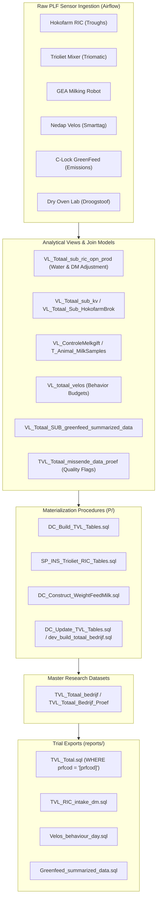

# Dairy Campus Data Processing & Calculation Methodologies

## 1. Overview

The Dairy Campus Research Data Platform processes high-frequency, multi-sensor data streams generated by automated precision livestock farming (PLF) equipment in Leeuwarden, the Netherlands. 

This directory contains the SQL implementation models (**Stored Procedures**, **Views**, and **Functions**) that perform extraction, transformation, quality validation, dry-matter adjustment, and temporal aggregation across all research trials.

```
calculations/
├── procedures/   # Stored procedures managing ETL, daily builds, and indexing
├── views/        # Analytical views modeling sensor joins, corrections, and aggregates
├── functions/    # Deterministic mathematical, calendar, and feed functions
└── reports/      # Canonical full-cohort aggregation models (e.g., DCTotaal.sql)
```

---

## 2. Core Calculation Methodologies

### 2.1 Roughage Intake & Dry Matter (DM) Calculations

Roughage intake is monitored using automated **Hokofarm RIC (Roughage Intake Control)** troughs equipped with sensitive load cells and RFID animal transponders.

#### Fresh Roughage Intake
Every visit to a RIC trough records the animal ID, trough number, entry timestamp, exit timestamp, initial trough mass, and final trough mass.
$$\text{Intake}_{\text{visit}} = \text{TroughWeight}_{\text{start}} - \text{TroughWeight}_{\text{end}}$$
The daily fresh roughage intake per cow per roughage fraction ($rv_1, rv_2, rv_3, rv_4$) is computed as:
$$\text{Intake}_{\text{fresh}} = \sum_{\text{visits}} \text{Intake}_{\text{visit}}$$

#### Water Exclusion Correction
When total mixed rations (TMR) are prepared using the **Trioliet Triomatic automated feeding robot**, water is frequently added to optimize ration moisture and prevent feed sorting. The actual feed intake must exclude this added water:
$$\text{WaterRatio} = \frac{\sum \text{TotalLoaded} - \sum \text{AddedWaterKg}}{\sum \text{TotalLoaded}}$$
$$\text{Intake}_{\text{excl\_water}} = \text{Intake}_{\text{fresh}} \times \text{WaterRatio}$$

#### Laboratory Dry Matter Content
Weekly representative samples of each roughage fraction and mixed ration are analyzed in the Dairy Campus drying oven laboratory (`droogstoof`, recorded in [`VL_totaal_droogstoof.sql`](views/VL_totaal_droogstoof.sql)). The weekly average dry matter percentage is computed by [`WeekGemiddelde_DS.sql`](functions/WeekGemiddelde_DS.sql):
$$\text{DM}_{\%} = \frac{\text{DrySampleWeight}}{\text{FreshSampleWeight}} \times 100\%$$

#### Total Daily Dry Matter Intake (DMI)
$$\text{tot.opnDs} = \sum_{i=1}^{4} \left( \text{Intake}_{\text{excl\_water}, i} \times \frac{\text{DM}_{\%, i}}{100} \right)$$
*(Implemented in [`VL_Totaal_sub_ric_opn_prod.sql`](views/VL_Totaal_sub_ric_opn_prod.sql) and materialized in `TVL_total`)*.

---

### 2.2 Concentrate Intake Calculations

Concentrate feed is dispensed through two independent systems:
1. **SAC / Hokofarm Automated Concentrate Stations**: Individual feeding stalls dispensing up to 4 distinct concentrate types (A, B, C, D).
2. **Milking Robot / Parlor Concentrate Feeders (GEA)**: In-parlor feeding during milking events (`KvMlk1`, `KvMlk2`, `C21-9`, `C21-10`, `DelPro-13`).

The daily intake is derived as:
$$\text{Intake}_{\text{concentrate}} = \text{ProgrammedFeed} - \text{RemainingUnconsumedFeed}$$
- Programmed allowance is tracked as `AtributedKVA`, `AtributedKVB`, etc.
- Consumed intake is tracked as `TotalIntakeKVA`, `TotalIntakeKVB`, etc.
*(Implemented in [`VL_Totaal_sub_kv.sql`](views/VL_Totaal_sub_kv.sql) and [`VL_Totaal_Sub_HokofarmBrok.sql`](views/VL_Totaal_Sub_HokofarmBrok.sql))*.

---

### 2.3 Milk Recording (MPR) Formulas & Quality Metrics

Milk yield and milk quality parameters are collected through two complementary mechanisms:
1. **Automated Milking Sensors (GEA)**: Real-time electronic yield recording per session, morning milk (`KgMlkO`), evening milk (`KgMlkA`), and 24-hour total daily yield:
   $$\text{KgMlkEtm} = \text{KgMlkO} + \text{KgMlkA}$$
2. **Official Milk Production Recording (MPR / MelkProductieRegistratie)**: Routine laboratory analysis (infrared spectroscopy) of individual cow milk samples taken during 4-weekly test days or experimental AO sampling (Tuesday evening and Wednesday morning).

#### 1. AO (Evening / Morning) Yield-Weighted Composite Formula
In trial sampling, milk samples are taken during both the evening ($A$) and morning ($O$) milking sessions. Because milk yield and component concentrations vary between morning and evening intervals, the daily composite concentration is computed as a **yield-weighted average** in [`VL_Dier_Datum_Crv.sql`](views/VL_Dier_Datum_Crv.sql):

$$\bar{C}_{\text{component}} = \frac{C_{\text{evening}} \times Y_{\text{evening}} + C_{\text{morning}} \times Y_{\text{morning}}}{Y_{\text{evening}} + Y_{\text{morning}}} = \frac{\sum_{i \in \{A, O\}} C_i \times Y_i}{\sum_{i \in \{A, O\}} Y_i}$$

Where:
- $C_i$ = Component concentration in sample $i$ ($\text{Fat\%}$, $\text{Protein\%}$, $\text{Lactose\%}$, $\text{Urea}$, $\text{SCC}$).
- $Y_i$ = Actual milk yield of milking $i$ (from GEA or calibrated milk meter).

*Note*: The database logic enforces `HAVING count(milking_begin_datetime) > 1` and `(count(nullif(Concentration, 0)) - 1)`, guaranteeing that both sessions are valid before generating the official daily concentration.

#### 2. Official Test Day Parameters (`T_Animal_MilkSamples`)
- **`MlkStd`**: Milk yield on official recording date (kg).
- **`VetStd`**: Milk fat percentage (%).
- **`EiwStd`**: Milk crude protein percentage (%).
- **`LacStd`**: Milk lactose percentage (%).
- **`UreStd`**: Milk urea content (mg/dL).
- **`CelStd`**: Somatic cell count (SCC, in 1,000 cells/mL), indicative of udder health and subclinical mastitis.
- **`KetStd`**: Diagnostic ketosis code based on beta-hydroxybutyrate (BHB) concentration (0 = healthy, 1 = suspect, 2 = clinical).

#### 3. Weekly Rolling CRV Milk Quality (`VL_Dier_Datum_Crv.sql`)
ISO-calendar week averages are calculated across test samples in view [`VL_Dier_Datum_Crv.sql`](views/VL_Dier_Datum_Crv.sql):
- `mpr_week.Fat_Concentration`, `mpr_week.Protein_Concentration`, `mpr_week.Lactose_Concentration`, `mpr_week.SCC`, `mpr_week.Urea_Concentration`.

---

### 2.4 Cow Behaviour Budgets (Nedap Velos)

Cows are outfitted with **Nedap Smarttags** (accelerometer neck collars or leg pedometers) transmitting behavioral activity intervals into `T_RAW_velos_behaviour`:
- `type = 0`: Other / active standing / walking
- `type = 1`: Inactive / lying resting
- `type = 2`: Ruminating
- `type = 3`: Eating / grazing

In [`Velos_behaviour_day.sql`](../reports/Velos_behaviour_day.sql) and views, durations in seconds are accumulated over each 24-hour calendar window:
$$\text{EatingTime} = \sum_{\text{type}=3} \text{Duration}_{\text{seconds}}$$
$$\text{RuminatingTime} = \sum_{\text{type}=2} \text{Duration}_{\text{seconds}}$$
$$\text{InactiveTime} = \sum_{\text{type}=1} \text{Duration}_{\text{seconds}}$$

---

### 2.5 Enteric Greenhouse Gas Emissions (C-Lock GreenFeed)

Dairy Campus operates **C-Lock GreenFeed** automated monitoring units to measure enteric methane ($\text{CH}_4$) and carbon dioxide ($\text{CO}_2$) fluxes.
1. The cow enters the GreenFeed hood, identified by RFID ear tags (`T_RAW_Greenfeed_RFID_data`).
2. Pelleted bait feed is dropped in calibrated cups (`Greenfeed_feed_aggregrated`) to encourage head proximity.
3. Air is drawn past the cow's muzzle into an infrared gas sensor manifold.
4. Mass emission fluxes (grams $\text{CH}_4$/day and grams $\text{CO}_2$/day) are calculated by integrating flow rate, gas differential concentrations, and background air levels over visits lasting at least 2 to 3 minutes.
5. Calibrated and quality-checked records are summarized in [`T_RAW_Greenfeed_Summarized_Data`](views/TVL_Totaal_SUB_greenfeed_summarized_data.sql).

---

### 2.6 Data Quality Control & Missing Data Detection

View [`TVL_Totaal_missende_data_proef.sql`](views/TVL_Totaal_missende_data_proef.sql) runs continuous validation checks per cow per day:
- **Milking Completeness**: Flags milking cows (`prdsta = 'Melk'`) having 0 or null milk yield for morning or evening sessions.
- **Body Weight**: Flags missing automated weights outside seasonal maintenance windows.
- **Feed Intake Outliers**: Flags lactating cows in roughage groups with 0 roughage or concentrate intake.
- **Sensor Integrity**: Flags days where total logged Nedap Velos duration is $< 50,000$ seconds (indicating transponder detachment, hardware fault, or battery depletion).
- **Body Condition Scoring**: Tracks presence of 3D DeLaval BCS camera records.

---

## 3. Database Execution Flow



---

## 4. Key Calculation Files

- **Master procedures**:
  - [`DC_Build_TVL_Tables.sql`](procedures/DC_Build_TVL_Tables.sql): Core orchestrator creating indexed performance tables from analytical views.
  - [`dev_build_totaal_bedrijf.sql`](procedures/dev_build_totaal_bedrijf.sql): Historical date loop materializing daily records into `tvl_totaal_bedrijf`.
  - [`SP_INS_Trioliet_RIC_Tables.sql`](procedures/SP_INS_Trioliet_RIC_Tables.sql): Builds feeding robot and roughage intake tables.
  - [`DC_Construct_WeightFeedMilk.sql`](procedures/DC_Construct_WeightFeedMilk.sql): Ingests and harmonizes milkings, weighings, and concentrate feedings.
- **Key Views**:
  - [`VL_totaal_bedrijf.sql`](views/VL_totaal_bedrijf.sql): Primary 100+ column master integration view.
  - [`VL_Totaal_sub_ric_opn_prod.sql`](views/VL_Totaal_sub_ric_opn_prod.sql): Roughage intake, water exclusion, and dry matter conversion.
  - [`TVL_Totaal_missende_data_proef.sql`](views/TVL_Totaal_missende_data_proef.sql): Quality control and missing observation matrix.
- **Functions**:
  - [`WeekGemiddelde_DS.sql`](functions/WeekGemiddelde_DS.sql): Calculates dry matter percentage weekly averages.
  - [`ExpectedCalvingDate.sql`](functions/ExpectedCalvingDate.sql): Computes projected calving date from confirmed inseminations.
